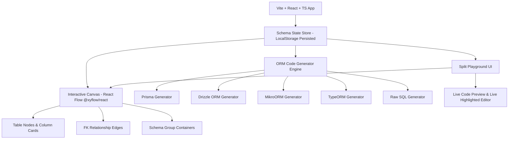

# Implementation Plan - Database Schema Playground & ORM Code Generator

Create a high-performance, modern, interactive web application built with **Vite, React, TypeScript, React Flow (@xyflow/react), and Lucide Icons**. The app empowers users to visually design database schemas, tables, fields, and relationships on an interactive canvas (similar to SSMS diagram view / dbdiagram.io) and instantly preview generated code for **Prisma, Drizzle ORM, MikroORM, TypeORM, and SQL**.

---

## Scope & Core Focus

- Interactive visual playground canvas with node dragging, zoom/pan, foreign-key link creation, table/column/schema CRUD, pre-built templates (e.g., E-Commerce, SaaS), and **real-time code generation** for 5 major target formats (**Prisma, Drizzle ORM, MikroORM, TypeORM, and PostgreSQL/MySQL SQL**).
- **Bidirectional Editing Foundation**: Visual edits on the canvas immediately update all ORM code models in real time, and editing code directly in the syntax-highlighted editor updates the visual canvas instantaneously!

---

## Architecture & Tech Stack

### Key Technologies:
1. **Build Tool & Framework**: Vite + React 18 + TypeScript
2. **Canvas / Diagram Engine**: `@xyflow/react` (React Flow v12) - support node dragging, custom table nodes, dynamic handles per column, zooming, panning, minimap, controls, auto-layout.
3. **Styling**: Modern CSS with custom theme variables, sleek dark theme, glassmorphism, responsive split panels with adjustable splitters.
4. **Code Syntax Highlighting**: PrismJS syntax highlighting tokens & custom dark theme.
5. **ORM Code Generation Engine**: Pure TypeScript AST/Template generators producing formatted code for Prisma, Drizzle ORM, MikroORM, TypeORM, and SQL.
