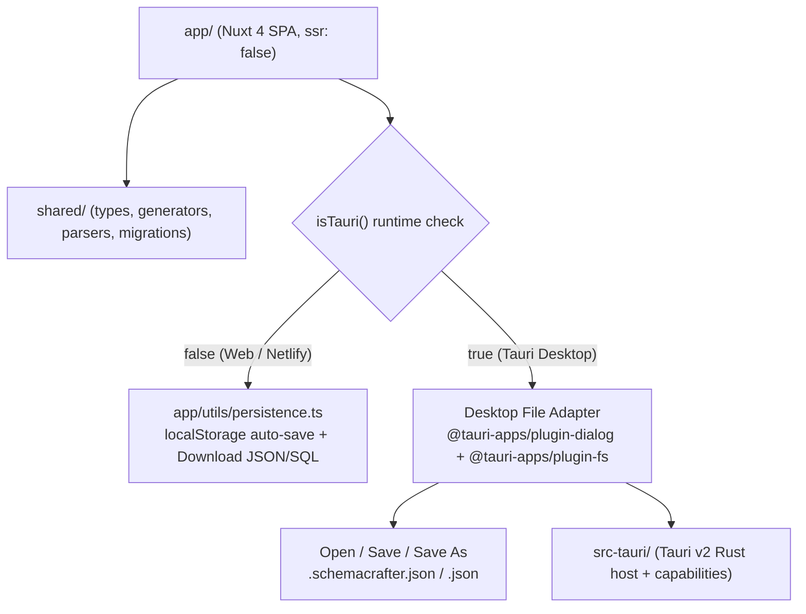

# Tauri Desktop App — Overview & Architecture

This document outlines the plan for adding a **Tauri v2 desktop version** of SchemaCrafter inside this repository while keeping the **Web version** unchanged.

---

## Goals & Product Split

| Concern | Web Version (Netlify) | Desktop App (Tauri v2) |
| --- | --- | --- |
| **Account / Server** | None (no login, no backend) | None (100% local) |
| **Persistence** | Browser `localStorage` auto-save (current behavior) | Native file-based **Open / Save / Save As** on disk |
| **Distribution** | Static SPA deployed from `main` via `pnpm generate` → `dist/` | Native installers/binaries bundled from `dist/` + `src-tauri/` |
| **Shared Code** | `app/` + `shared/` | Exact same `app/` + `shared/` |

### Why keep both in one repository?
- `nuxt.config.ts` already runs with `ssr: false` and builds static assets into `dist/` via `pnpm generate`.
- `shared/` (types, SQL/ORM generators, parsers, graph layout, migrations) has no browser or server coupling.
- `app/utils/persistence.ts` isolates storage access, and `app/stores/workspace.ts` already exposes `replaceWorkspace(next)` and `hydrate()`.
- Adding `src-tauri/` to this repo keeps one source of truth for UI, parsers, generators, and schema migrations while Netlify continues deploying the web build unaffected.

---

## High-Level Architecture

### Runtime Boundary Rule
- **Web stays identical:** When running in a browser (`!isTauri()`), SchemaCrafter continues reading/writing `localStorage` via `loadWorkspace()` and `saveWorkspace()` in `app/utils/persistence.ts`.
- **No Tauri assumptions in web builds:** All `@tauri-apps/*` calls are guarded by `isTauri()` (and loaded cleanly so Vite/Nuxt `pnpm generate` on Netlify succeeds with no Rust toolchain installed).

---

## Implementation Milestones

1. **Phase 1 — Tauri Scaffolding & Build Integration** (see [tauri-setup-guide.md](./tauri-setup-guide.md))
   - Install `@tauri-apps/cli`, `@tauri-apps/api`, `@tauri-apps/plugin-dialog`, and `@tauri-apps/plugin-fs`.
   - Initialize `src-tauri/` configured against `pnpm dev` (`http://localhost:3000`) and `pnpm generate` (`../dist`).
   - Update `.gitignore` and `eslint.config.mjs` to ignore Rust build artifacts (`src-tauri/target`).
   - Configure Tauri v2 capabilities (`src-tauri/capabilities/default.json`).
   - Verify `pnpm generate`, `pnpm lint`, `pnpm typecheck`, `pnpm test`, and `pnpm tauri dev`.

2. **Phase 2 — Native File Open / Save** (see [tauri-file-persistence.md](./tauri-file-persistence.md))
   - Add `isTauri()` detection in `app/utils/runtime.ts`.
   - Implement `Open`, `Save`, `Save As`, and `New` project file workflows in Tauri using `@tauri-apps/plugin-dialog` and `@tauri-apps/plugin-fs`.
   - Support opening both full `Workspace` v2 files and single `DatabaseProject` JSON files exported from the web **Download JSON** menu.
   - Track `currentFilePath` and `isDirty` state in the desktop UI (title/indicator + unsaved-changes confirmation via `useConfirm`).

3. **Phase 3 — OS Integration & Release Packaging (Optional)**
   - Register `.schemacrafter` / `.schemacrafter.json` file associations in `src-tauri/tauri.conf.json` and handle `RunEvent::Opened` in `src-tauri/src/lib.rs`.
   - Add GitHub Actions workflow (triggered on desktop release tags) to build `.dmg` / `.AppImage` / `.deb` / `.msi` installers without affecting Netlify web deploys.
